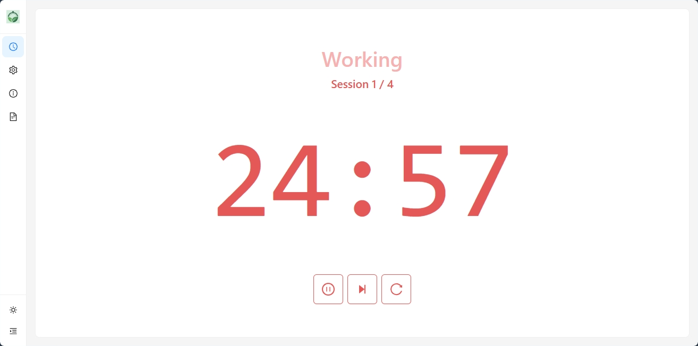
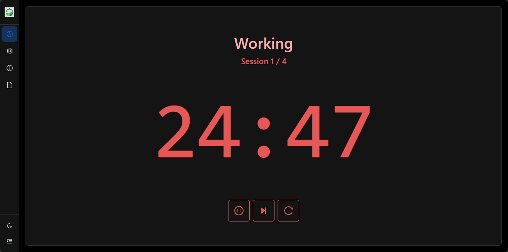
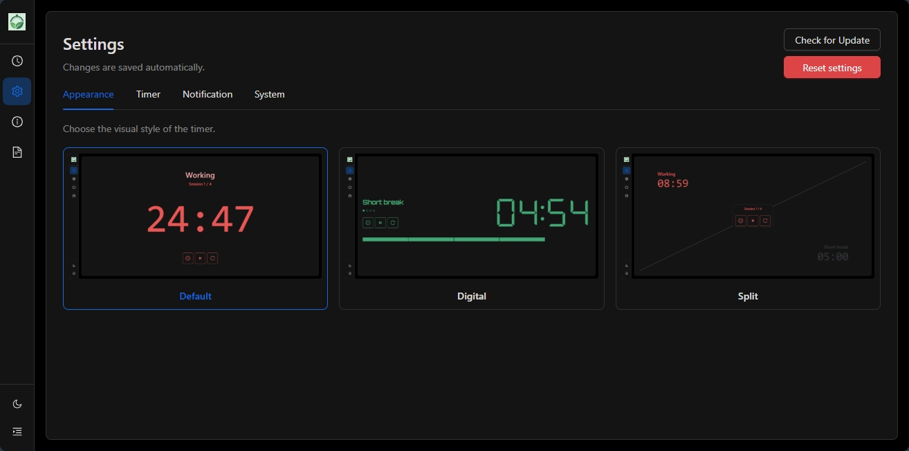
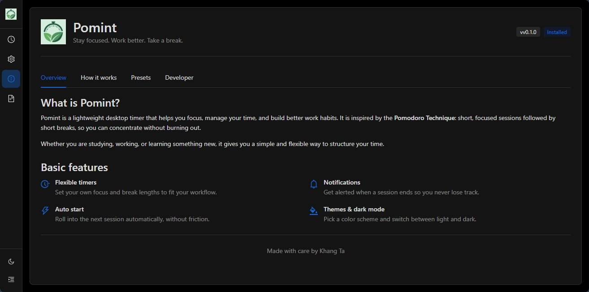

  

# Pomint

A simple Pomodoro timer for Windows that helps you stay focused by breaking work into intervals and short breaks. Pomint cycles through work, short break and long break sessions, and keeps your progress when you restart the app.

## Basic features

- Three timer styles: **Default**, **Digital** and **Split**.
- Work, short break and long break modes with **Start/Pause**, **Skip** and **Reset** controls.
- Configurable work, break and long break durations, sessions before a long break, and auto-start for work/break sessions.
- Settings and session progress are saved; after a restart the timer returns paused with elapsed time accounted for.
- Desktop notifications and a separate alarm on/off switch with volume control.
- Minimize to the system tray when closing the window, with live status and controls in the tray menu.
- Light and dark themes.
- Installed builds can check for and install updates from GitHub Releases; portable builds do not support auto-update.
- About and in-app Changelog pages.

## Screenshots

| Timer (light)                                                    | Timer (dark)                                                   |
| ---------------------------------------------------------------- | -------------------------------------------------------------- |
|  |  |

| Settings                                         | About                                            |
| ------------------------------------------------ | ------------------------------------------------ |
|  |  |

## Installation

Pomint is currently released for Windows only.

1. Open the latest release: https://github.com/Aquarius2301/Pomint/releases.
2. Download one of these assets:
   - `Pomint-<version>-installer.exe` — recommended. Installs Pomint and supports automatic updates.
   - `Pomint-<version>-portable.exe` — standalone executable; no installation and no automatic updates.

3. Run the downloaded `.exe`. Follow the installer prompts, or just run the portable file directly.
4. Ignore `latest.json` and `.sig`; they are updater metadata, not installation options.

> **Browser or Windows Defender warning:** If your browser or Windows Defender blocks the download with a virus/SmartScreen warning, choose **Keep** / **Allow** to continue. Pomint is not Authenticode-signed yet, so false positives are possible. Only allow the file if it came from the official releases page above.

## Development

If you want to build Pomint from source or customize it, see [DEVELOPMENT.md](DEVELOPMENT.md).

## Tech Stack

React · TypeScript · Vite · Tauri · Rust · Ant Design · Zustand

## License

Pomint is licensed under the [MIT License](LICENSE). Copyright (c) 2026 Khang Ta.
